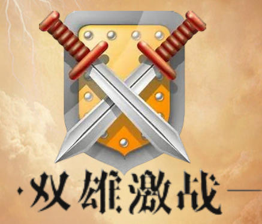
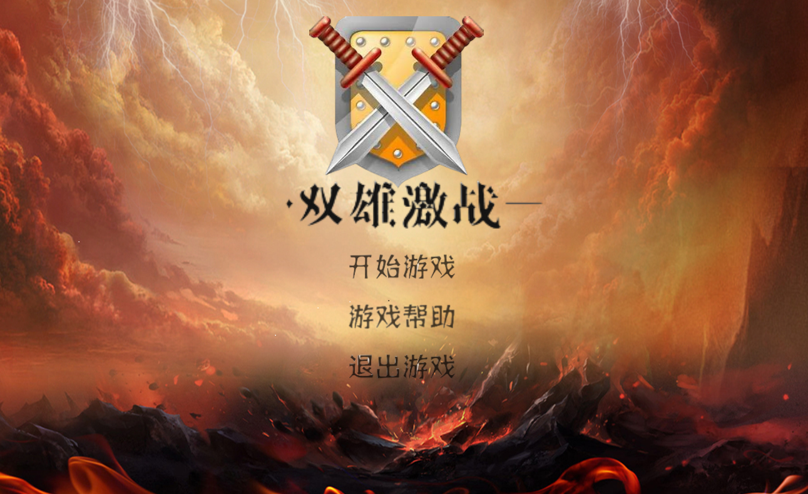
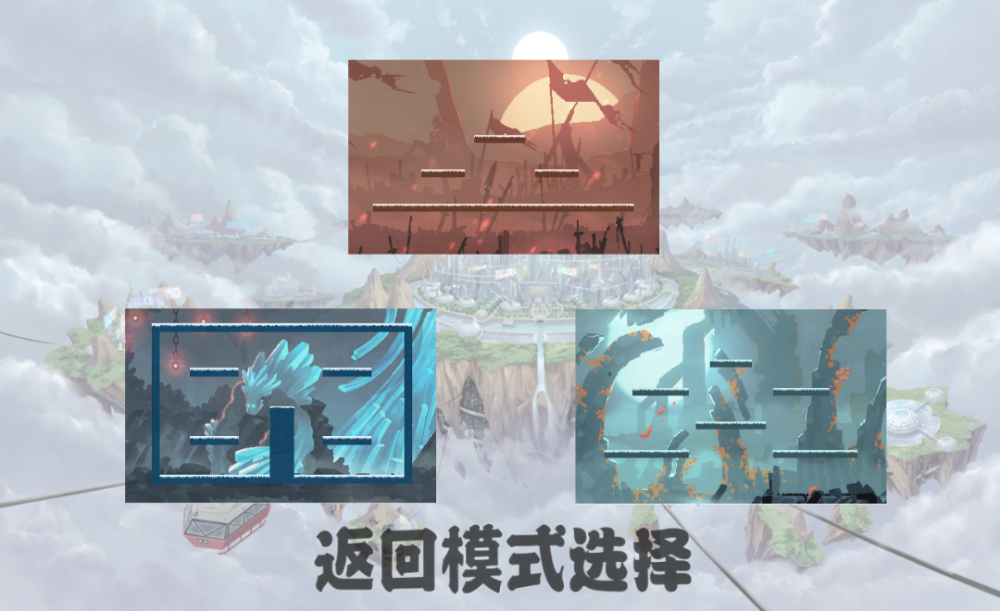
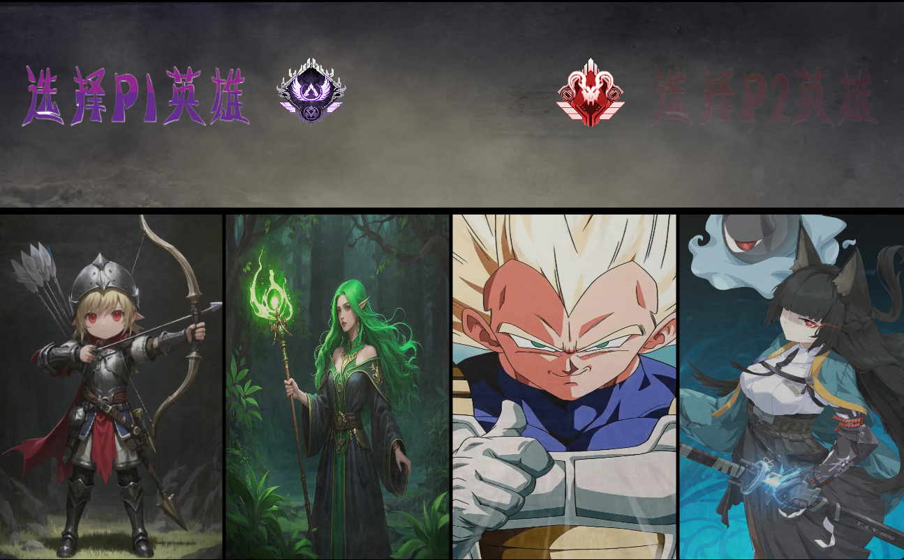
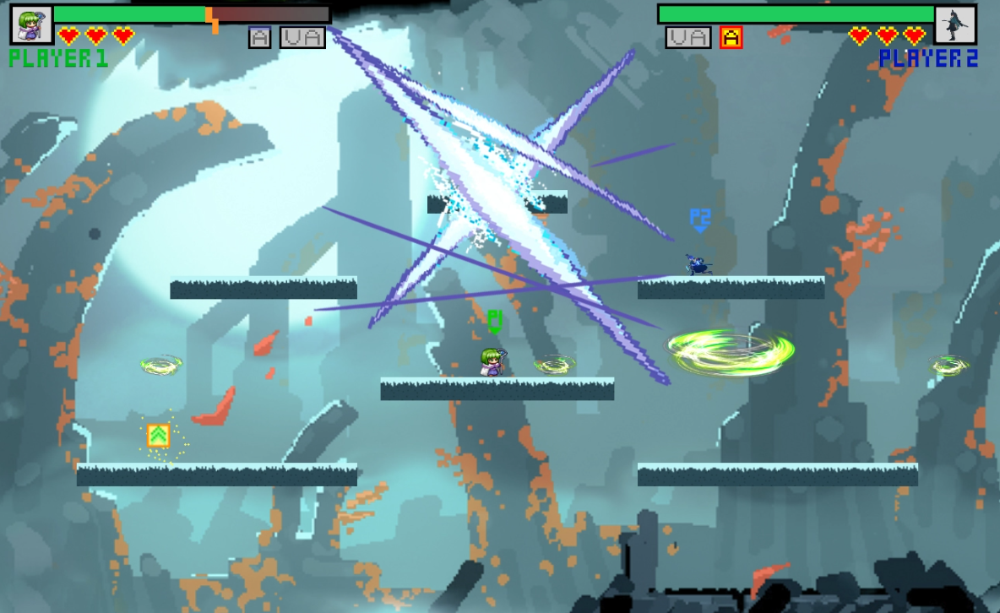
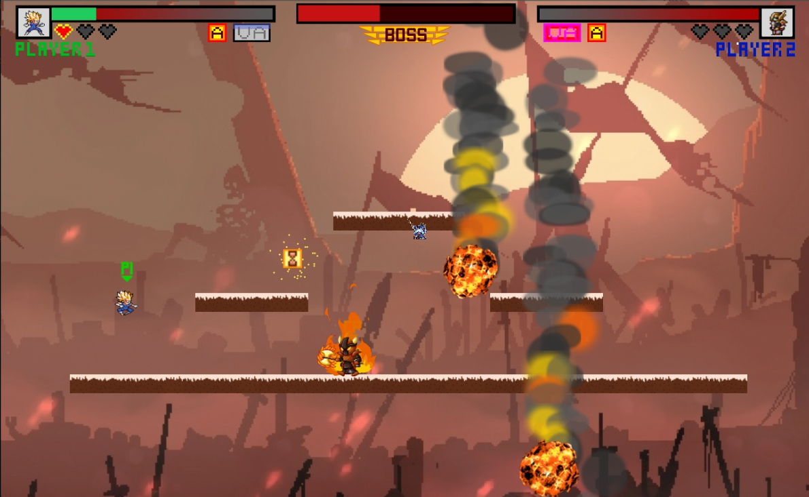
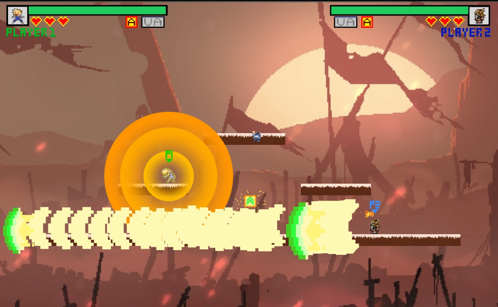
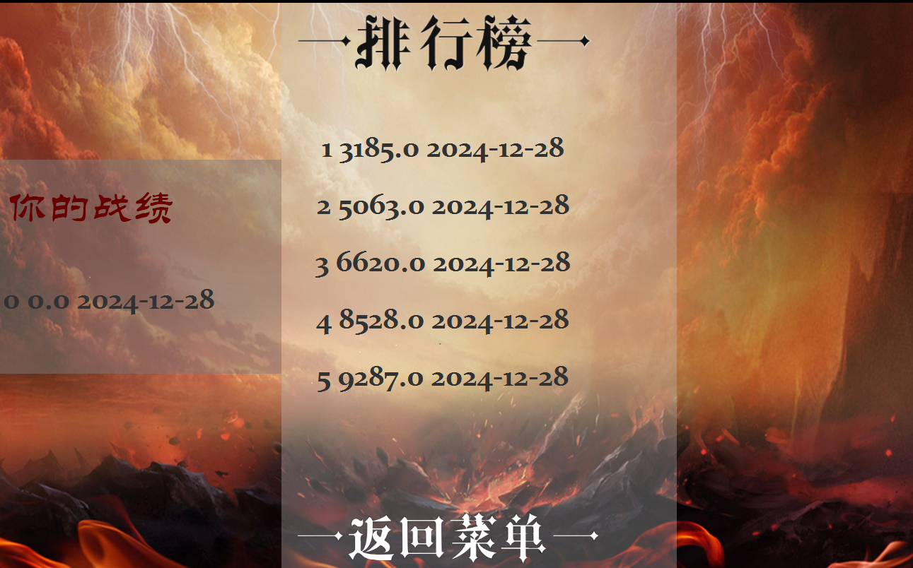
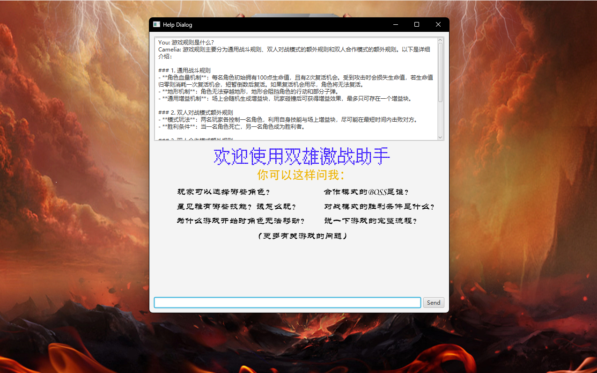

<div align="center">
  

  # 双雄激战

  **基于 JavaFX 的 PC 横版双人格斗 / 合作小游戏**

  Java 17 · JavaFX 17.0.6 · Maven · MySQL 8.0 · Coze(扣子) AI

</div>

---

## 项目简介

《双雄激战》是一款运行在 PC 端的横版动作小游戏，使用 Java + JavaFX 从零实现。
它支持**本地双人同屏**，提供 **双人对战** 与 **双人合作（Boss 战）** 两种核心模式，
并配有完整的角色选择、关卡选择、增益道具、复活机制、结算界面，以及基于云数据库的**在线排行榜**。

游戏还内置了一个 **AI 用户助手**：通过 Coze（扣子）Bot 的流式接口，实时回答玩家关于规则、角色技能、
玩法流程等问题，降低上手门槛。

## 游戏截图

| 主菜单 | 模式选择 |
| :---: | :---: |
|  |  |

| 角色选择 | 对战实机（冰原） |
| :---: | :---: |
|  |  |

| 合作模式 · Boss 战 | 技能实机（激光） |
| :---: | :---: |
|  |  |

| 在线排行榜 | AI 用户助手 |
| :---: | :---: |
|  |  |

## 玩法与功能

- **双人对战**：两名玩家各选一名角色，利用自身技能与地形增益，在最短时间内击败对方。
- **双人合作**：两名玩家协作挑战 Boss，Boss 拥有独立血条、召唤与范围技能；双人同时阵亡则失败。
- **角色系统**：4 名可选角色，每人拥有普攻、技能与大招，弹道、粒子、音效各不相同。
- **增益机制**：场上随机刷新增益块，玩家碰撞后获得增益（加血 / 护盾 / 加速 / 加时等），同屏最多存在一个。
- **生命与复活**：角色初始 100 点生命，带 2 次复活机会；生命值归零消耗一次复活，复活次数用尽即阵亡。
- **地形与物理**：角色无法穿越地形，地形会阻挡角色移动和部分子弹，并包含重力、碰撞检测等物理表现。
- **在线排行榜**：战斗结束后将通关用时上传至云端 MySQL 数据库，排行榜按用时升序展示。
- **AI 用户助手**：游戏内帮助对话框接入 Coze Bot，以 SSE 流式方式边生成边显示回答。
- **机器人与寻路**：合作模式中的 Bot 使用 Dijkstra 算法在关卡航点图上计算路径。

## 角色

| 角色 | 定位 | 招式示例 |
| --- | --- | --- |
| Archer（弓箭手） | 远程输出 | 普通箭、强化箭、弓箭大招（范围爆炸） |
| Cecil（绿法师） | 法术 / 控场 | 追踪弹、流星技能、范围爆炸 |
| Hoshimi Miyabi（星见雅） | 近战突进 | 刀光连斩、突进、强化普攻 |
| Vegeta（贝吉塔） | 爆发 / 硬直 | 上勾拳、气功波、终极爆气 |

## 技术栈

| 分类 | 选型 |
| --- | --- |
| 语言 | Java 17 |
| 界面 | JavaFX 17.0.6（controls / media / fxml） |
| 构建 | Maven 3.9.9 |
| 数据库 | MySQL 8.0（云数据库 RDS） |
| JSON | Gson 2.8.6 |
| 测试 | JUnit 5 |
| AI | Coze（扣子）Bot API（SSE 流式） |
| 开发环境 | IntelliJ IDEA Ultimate 2024 |

## 目录结构

```text
.
├── 01-项目源代码与环境安装说明/
│   ├── 环境安装说明.txt
│   └── Game/                        # Maven 工程根目录
│       ├── pom.xml
│       ├── mvnw / mvnw.cmd
│       └── src/main/
│           ├── java/
│           │   ├── module-info.java
│           │   └── org/example/
│           │       ├── gametest/    # 入口 HelloApplication
│           │       ├── Controller/  # 各界面控制器
│           │       ├── Scenes/      # 战斗主场景与游戏循环
│           │       ├── Sprite/      # 角色、子弹、粒子、UI 精灵
│           │       ├── DataBase/    # 云数据库读写
│           │       ├── AI/          # Coze AI 助手接口
│           │       └── sound/       # 音效播放
│           └── resources/
│               ├── Images/          # 角色、背景、子弹、粒子等美术资源
│               ├── Music/           # 背景音乐与音效
│               ├── org/             # FXML 界面文件
│               ├── Navigations/     # 关卡寻路数据
│               └── txt/             # 排行榜本地缓存
├── 02-小组文档资料/                 # 项目计划、需求、详细设计、测试跟踪表
├── 03-小组评审PPT/                  # 小组评审演示 PPT
├── 04-用户手册/                     # 用户操作手册
├── 如何编写自机角色（内部自用）.docx
└── screenshots/                     # README 截图
```

## 快速开始

### 1. 环境要求

- JDK 17
- Maven 3.9+（仓库已自带 `mvnw`）
- MySQL 8.0（本地或云端均可）
- 建议使用 IntelliJ IDEA Ultimate 2024 打开工程

### 2. 准备数据库

在 MySQL 中创建数据库与成绩表（字段与源码中的查询一致）：

```sql
CREATE DATABASE IF NOT EXISTS test_1 DEFAULT CHARACTER SET utf8mb4;

USE test_1;

CREATE TABLE IF NOT EXISTS scores_record (
  id          INT AUTO_INCREMENT PRIMARY KEY,
  finish_time DOUBLE,
  finish_date DATE
);
```

### 3. 配置连接信息

打开 `01-项目源代码与环境安装说明/Game/src/main/java/org/example/DataBase/DataBaseConnection.java`，
把 `url` / `username` / `password` 换成你自己的数据库连接信息。

如需使用 AI 助手，请打开
`01-项目源代码与环境安装说明/Game/src/main/java/org/example/AI/CozeApiExample.java`，
把 `Authorization` 中的 `Bearer <your-coze-api-token>` 换成你自己的 Coze 个人访问令牌。

> 本仓库中的数据库凭据与 Coze 令牌均已替换为占位符，直接运行前必须自行填写。

### 4. 运行

用 IDEA 直接运行主类 `org.example.gametest.HelloApplication`，或在 `Game` 目录下执行：

```bash
mvn clean javafx:run
```

> 注意：`pom.xml` 中 `javafx-maven-plugin` 的 `mainClass` 目前写的是
> `com.example.game/com.example.game.HelloApplication`，与实际模块名
> `org.example.gametest/org.example.gametest.HelloApplication` 不一致。
> 若命令行运行报找不到主类，请同步修改该配置（IDEA 直接运行主类不受影响）。

窗口默认尺寸为 1300 × 800。

## 文档资料

- `02-小组文档资料/`：项目计划、需求规格说明书、详细设计说明书、测试问题跟踪表
- `03-小组评审PPT/`：小组评审演示稿
- `04-用户手册/`：用户操作手册
- `如何编写自机角色（内部自用）.docx`：新增自定义角色的内部说明

## 说明

- 完整的**全流程演示视频**（AI 用户助手 + 双人对战 + 双人合作 + 排行榜演示，约 385 MB）体积超过
  GitHub 单文件 100 MB 的限制，未包含在本仓库中。
- 出于安全考虑，源码中原本硬编码的云数据库地址 / 账号 / 密码，以及 Coze API 访问令牌，
  在发布前已替换为占位符。
